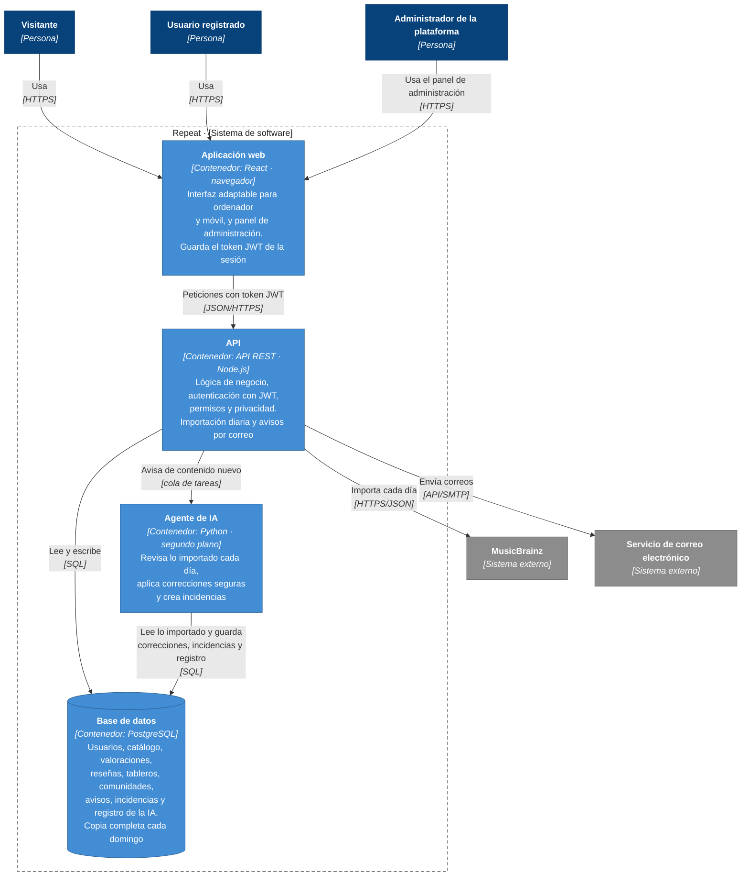

# Arquitectura · Diagrama C4 de contenedores (nivel 2)

El diagrama de contenedores abre la caja **Repeat** del [diagrama de contexto](c4-contexto.md). La entrega es solo web (ver [ADR-0004](../adr/0004-solo-web-y-sesion-jwt.md)): ya no hay contenedor de aplicación móvil.

Leyenda (notación C4): azul oscuro, personas; azul, contenedores de Repeat; gris, sistemas externos; línea discontinua, límite del sistema.

## Contenedores

| Contenedor | Tecnología propuesta | Responsabilidad | Historias principales |
| --- | --- | --- | --- |
| **Aplicación web** | React, adaptable (dos últimas versiones de Chrome, Firefox, Safari y Edge, en ordenador y móvil) | Interfaz para visitantes, usuarios registrados y, en el panel de administración, para el administrador de la plataforma: búsqueda, fichas, valoraciones, reseñas, perfil, favoritos, tableros, rankings, comunidades, incidencias, denuncias, catálogo y usuarios. No guarda datos propios: todo lo pide a la API con el token JWT de la sesión (RNF-01, RNF-11). | Todas |
| **API** | API REST, Node.js | Única puerta de entrada a los datos. Autentica con tokens JWT (RNF-11), comprueba en el servidor el rol y la privacidad de cada contenido (RNF-02), aplica las reglas de negocio, calcula medias, recomendaciones y el ranking semanal, y genera los avisos. Contiene la tarea programada que importa el catálogo cada día desde MusicBrainz y pide el envío de correos. | Todas; HU-20 (importación), HU-11 y HU-18 (correo) |
| **Base de datos** | PostgreSQL | Guarda toda la información de los requisitos de información (RI-01 a RI-21), con una copia de seguridad completa cada domingo (RNF-06). Las contraseñas se guardan cifradas (RNF-03). | Todas |
| **Agente de IA** | Python, proceso en segundo plano | Revisa solo el contenido de la importación diaria (duplicados, géneros incorrectos, portadas vacías, fechas imposibles). Aplica solo correcciones seguras y crea una incidencia para el resto; registra cada acción con fecha y motivo (RNF-07). Nunca borra contenido: eso lo decide el administrador (ver ADR-0003). | HU-21, HU-22 |

## Relaciones

| Origen → destino | Protocolo | Para qué |
| --- | --- | --- |
| Personas → Aplicación web | HTTPS | Usar la aplicación desde el ordenador o el móvil. El administrador usa el panel de administración. |
| Aplicación web → API | JSON sobre HTTPS, con token JWT | Todas las operaciones. La web envía en cada petición el token de la sesión (RNF-11). |
| API → Base de datos | SQL | Leer y guardar datos. |
| API → MusicBrainz | HTTPS/JSON | Importación diaria del catálogo sin duplicar elementos ni volver a importar lo que el administrador eliminó (RN-21). Si MusicBrainz no responde, se conserva el catálogo y se reintenta cada hora (RNF-05). En las pruebas se usa una versión simulada (RNF-10). |
| API → Agente de IA | Cola de tareas | Al terminar la importación diaria, la API deja una tarea para que el agente revise solo el contenido nuevo (RN-22). |
| Agente de IA → Base de datos | SQL | Lee lo importado y guarda correcciones automáticas, incidencias pendientes y el registro de sus acciones. |
| API → Servicio de correo | API/SMTP | Envío de la recuperación de contraseña y de los avisos al correo de registro (HU-11, HU-18, RNF-10). |
