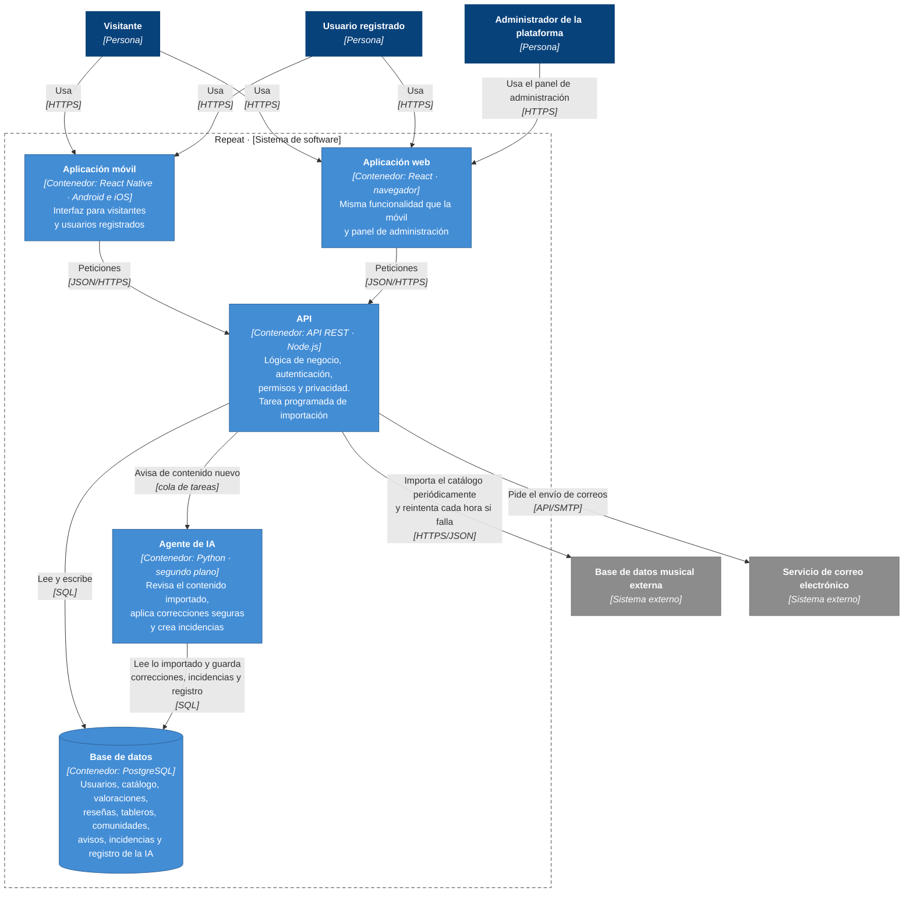

# Arquitectura · Diagrama C4 de contenedores (nivel 2)

El diagrama de contenedores abre la caja **Repeat** del [diagrama de contexto](c4-contexto.md) y muestra las piezas que se ejecutan por separado y cómo se comunican. Las dos aplicaciones usan una única API común (ver ADR-0001).

Leyenda (notación C4): azul oscuro, personas; azul, contenedores de Repeat; gris, sistemas externos; línea discontinua, límite del sistema.

> **Tecnologías:** las indicadas en el diagrama (React Native, React, Node.js, PostgreSQL y Python) son una propuesta para poder dibujar los contenedores. Si en los ADR se decide otra, basta con cambiar el texto entre comillas de cada contenedor.

## Contenedores

| Contenedor | Tecnología propuesta | Responsabilidad | Historias principales |
| --- | --- | --- | --- |
| **Aplicación móvil** | React Native (Android 10+ e iOS 15+) | Interfaz para visitantes y usuarios registrados: búsqueda, fichas, valoraciones, reseñas, perfil, favoritos, tableros, rankings, comunidades y avisos. No guarda datos propios: todo lo pide a la API. | Todas las de usuario (RNF-01) |
| **Aplicación web** | React (dos últimas versiones de Chrome, Firefox, Safari y Edge) | Las mismas funciones que la móvil sobre la misma información (RNF-01) y, para el administrador de la plataforma, el panel de incidencias del catálogo, denuncias de reseñas, catálogo y usuarios. | Todas las de usuario y HU-13, HU-22, HU-37, HU-40 |
| **API** | API REST, Node.js | Única puerta de entrada a los datos para las dos aplicaciones. Autentica, comprueba en el servidor el rol y la privacidad de cada contenido (RNF-02), aplica las reglas de negocio, calcula medias, recomendaciones y el ranking semanal, y genera los avisos. Contiene la tarea programada que importa el catálogo y pide el envío de correos. | Todas; HU-20 (importación) y HU-18 (correo) |
| **Base de datos** | PostgreSQL | Guarda toda la información de los requisitos de información (RI-01 a RI-20), con copia de seguridad diaria (RNF-06). Las contraseñas se guardan cifradas (RNF-03). | Todas |
| **Agente de IA** | Python, proceso en segundo plano | Revisa el contenido recién importado (duplicados, géneros incorrectos, portadas vacías, fechas imposibles). Aplica solo correcciones seguras y crea una incidencia para el resto; registra cada acción con fecha y motivo (RNF-07). Nunca borra contenido: eso lo decide el administrador (ver ADR-0003). | HU-21, HU-22 |

## Relaciones

| Origen → destino | Protocolo | Para qué |
| --- | --- | --- |
| Personas → Aplicación móvil / web | HTTPS | Usar la aplicación. El administrador usa solo la web. |
| Aplicación móvil / web → API | JSON sobre HTTPS | Todas las operaciones: las dos aplicaciones llaman a la misma API. |
| API → Base de datos | SQL | Leer y guardar datos. |
| API → Base de datos musical externa | HTTPS/JSON | Importación periódica del catálogo sin duplicar elementos ni volver a importar lo que el administrador eliminó (RN-21). Si la fuente no responde, se conserva el catálogo y se reintenta cada hora (RNF-05). |
| API → Agente de IA | Cola de tareas | Al terminar una importación, la API deja una tarea para que el agente revise el contenido nuevo. |
| Agente de IA → Base de datos | SQL | Lee lo importado y guarda correcciones automáticas, incidencias pendientes y el registro de sus acciones. El administrador ve las incidencias en la web a través de la API. |
| API → Servicio de correo | API/SMTP | Envío del enlace de recuperación de contraseña (RNF-10). |
