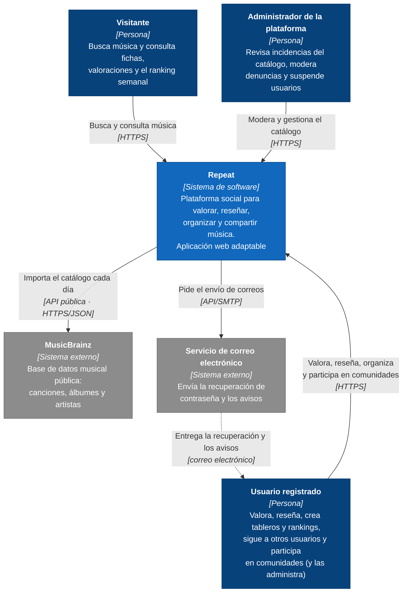

# Arquitectura · Diagrama C4 de contexto (nivel 1)

El diagrama de contexto muestra Repeat como una sola caja: quién lo usa y con qué sistemas externos se comunica. Repeat es una aplicación web adaptable, que se usa desde el navegador del ordenador o del móvil. Se comunica con MusicBrainz, de la que importa el catálogo cada día, y con un servicio de correo electrónico que envía la recuperación de contraseña y los avisos.

Leyenda (notación C4): azul oscuro, personas; azul, el sistema; gris, sistemas externos.
