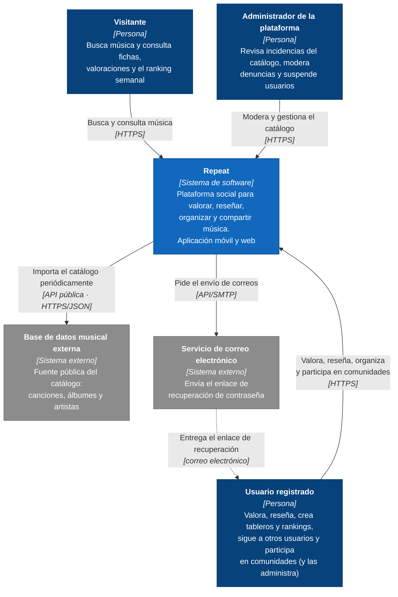

# Arquitectura · Diagrama C4 de contexto (nivel 1)

El diagrama de contexto muestra **Repeat** como una sola caja: quién lo usa y con qué sistemas externos se comunica. No entra en cómo está construido por dentro; eso se ve en el [diagrama de contenedores](c4-contenedores.md).

Leyenda (notación C4): azul oscuro, personas; azul, nuestro sistema; gris, sistemas externos.

## Elementos

| Elemento | Tipo | Descripción | Historias relacionadas |
| --- | --- | --- | --- |
| **Visitante** | Persona | Usa la aplicación sin cuenta. Puede buscar y consultar fichas, valoraciones y el ranking semanal, pero no puede valorar, reseñar ni guardar nada. | HU-03, HU-04, HU-15, HU-01, HU-02 |
| **Usuario registrado** | Persona | Usuario con cuenta. Valora y reseña, marca favoritos, crea tableros y rankings personales, sigue a otros usuarios, envía solicitudes de amistad y participa en comunidades. Si crea una comunidad o le nombran administrador, la gestiona (miembros, accesos y moderación de publicaciones); es el mismo actor con un rol dentro de esa comunidad. | HU-05 a HU-12, HU-14, HU-17 a HU-19, HU-23 a HU-36, HU-38, HU-39, HU-41 a HU-44 |
| **Administrador de la plataforma** | Persona | Gestiona la plataforma desde la versión web: revisa las incidencias que detecta el agente de IA, corrige o elimina contenido del catálogo, resuelve las denuncias de reseñas y suspende usuarios. | HU-13, HU-21, HU-22, HU-37, HU-40 |
| **Repeat** | Sistema (el nuestro) | La plataforma completa: aplicación móvil, aplicación web y todo lo que hay detrás. | Todas |
| **Base de datos musical externa** | Sistema externo | Fuente pública de la que se importan canciones, álbumes y artistas. Repeat no la consulta en cada búsqueda: copia el catálogo a su propia base de datos (ver ADR-0002), de modo que la aplicación sigue funcionando aunque la fuente no responda (RNF-05). | HU-20, HU-21 |
| **Servicio de correo electrónico** | Sistema externo | Servicio que envía los correos de la plataforma. En este sprint se usa para el enlace de recuperación de contraseña. Los avisos dentro de la aplicación (seguidores, solicitudes, invitaciones) no usan el correo. | HU-18 (RNF-10) |

## Relaciones

| Origen → destino | Qué se intercambia |
| --- | --- |
| Visitante → Repeat | Búsquedas y consultas de fichas y del ranking semanal. |
| Usuario registrado → Repeat | Valoraciones, reseñas, favoritos, tableros, rankings, relaciones sociales y publicaciones en comunidades. |
| Administrador → Repeat | Decisiones de moderación y cambios en el catálogo. |
| Repeat → Base de datos musical externa | Importación periódica del catálogo a través de su API pública; si la fuente falla, se reintenta cada hora (RNF-05). |
| Repeat → Servicio de correo | Petición de envío del correo de recuperación de contraseña. |
| Servicio de correo → Usuario | Entrega del enlace de recuperación, válido 24 horas (RN-03). |
