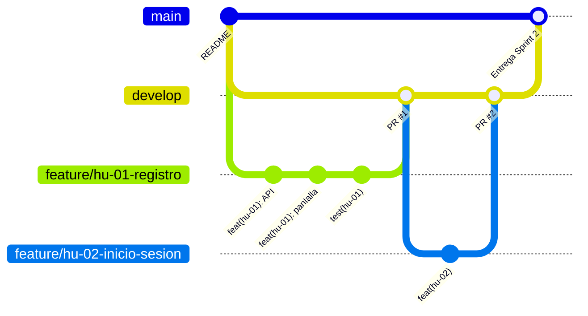

# Estrategia de ramas

El equipo sigue **GitHub Flow simplificado**, con una rama de integración. Ninguna rama protegida recibe cambios directos: todo entra mediante pull request revisado por otra integrante.

## Ramas

| Rama | Para qué sirve | Quién escribe en ella |
| --- | --- | --- |
| `main` | Versión estable que se entrega y se despliega. Está protegida. | Solo se fusiona `develop` mediante pull request aprobado. |
| `develop` | Rama de integración donde se juntan las historias terminadas. Está protegida. | Solo se fusionan ramas `feature/…` mediante pull request aprobado. |
| `feature/hu-XX-nombre-corto` | Una rama por historia de usuario. | La integrante que tiene asignada la historia. |
| `fix/descripcion-corta` | Corrección de un error encontrado en `develop`. | Quien lo corrige. |
| `docs/descripcion-corta` | Cambios solo de documentación. | Quien la edita. |

El nombre de la rama de cada historia está en su tarea del Planner. Por ejemplo: `feature/hu-01-registro`, `feature/hu-02-inicio-sesion` o `feature/hu-20-importar-catalogo`.

## Flujo de trabajo



1. **Antes de empezar**, actualiza `develop` y crea la rama de la historia desde ella:
   ```bash
   git checkout develop
   git pull
   git checkout -b feature/hu-01-registro
   ```
2. **Trabaja en la rama** con commits pequeños (ver la convención más abajo) y súbela a GitHub:
   ```bash
   git push -u origin feature/hu-01-registro
   ```
3. **Abre un pull request hacia `develop`** cuando la historia esté terminada. GitHub rellena la descripción con la [plantilla](../../.github/pull_request_template.md): descripción, issue relacionado (`Closes #número`) y lista de revisión.
4. **Revisión:** otra integrante revisa el código, lo prueba y lo aprueba. El pipeline de CI tiene que estar en verde.
5. **Fusión:** quien abrió el pull request lo fusiona con *Squash and merge*, para que cada historia quede como un solo commit en `develop`, y borra la rama.
6. **Entrega:** al final del Sprint se abre un pull request de `develop` a `main`, se revisa y se fusiona con *Create a merge commit*.

Si `develop` ha cambiado mientras trabajabas, actualiza tu rama antes de abrir el pull request:

```bash
git checkout develop
git pull
git checkout feature/hu-01-registro
git merge develop
```

## Mensajes de commit

Formato: `tipo(ámbito): descripción breve en presente`.

| Tipo | Cuándo |
| --- | --- |
| `feat` | Nueva funcionalidad |
| `fix` | Corrección de un error |
| `test` | Añadir o cambiar tests |
| `docs` | Documentación |
| `refactor` | Cambio de código que no cambia el comportamiento |
| `chore` | Configuración, dependencias, pipeline |

Ejemplos: `feat(hu-01): validar el formato del correo`, `test(hu-02): login con contraseña incorrecta`, `chore(ci): añadir informe de cobertura`.

## Reglas de protección

Configuradas en GitHub (*Settings → Rules → Rulesets*) para `main` y `develop`:

- No se puede hacer push directo: los cambios entran por pull request.
- Cada pull request necesita **1 aprobación** de otra integrante.
- Si se suben cambios después de la aprobación, hay que volver a aprobar.
- Todas las conversaciones del pull request tienen que estar resueltas.
- El pipeline de CI (`.github/workflows/ci.yml`) tiene que pasar antes de fusionar.
- No se pueden borrar las ramas ni reescribir su historial (*force push*).
