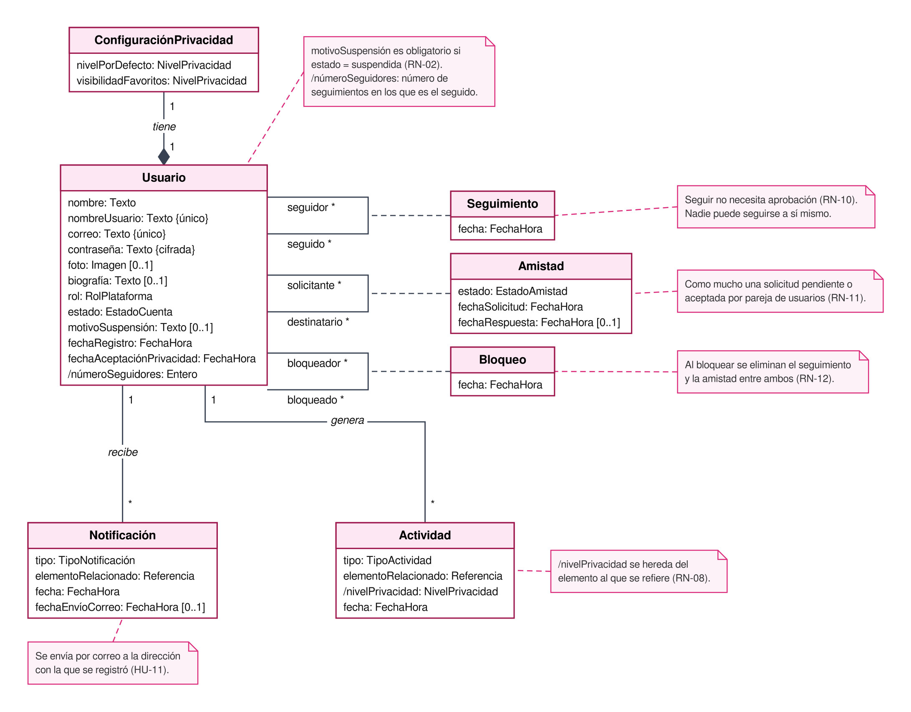
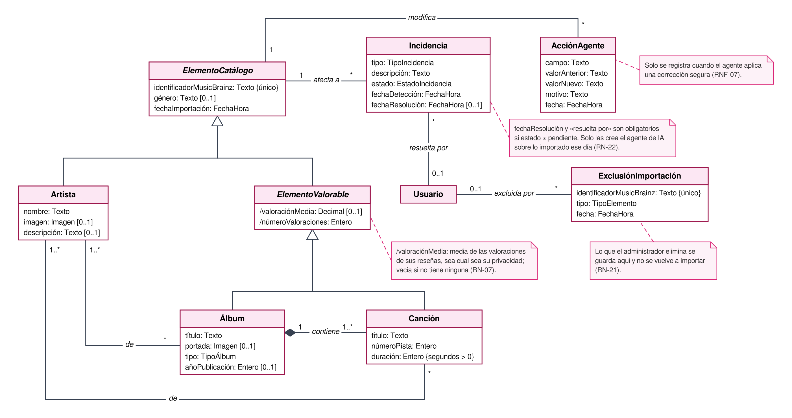
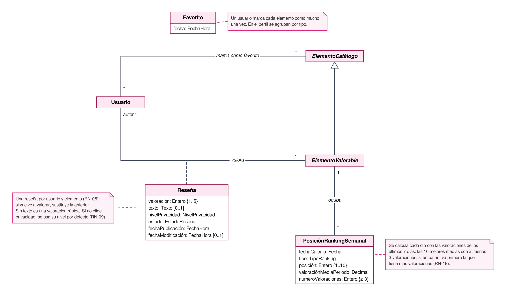
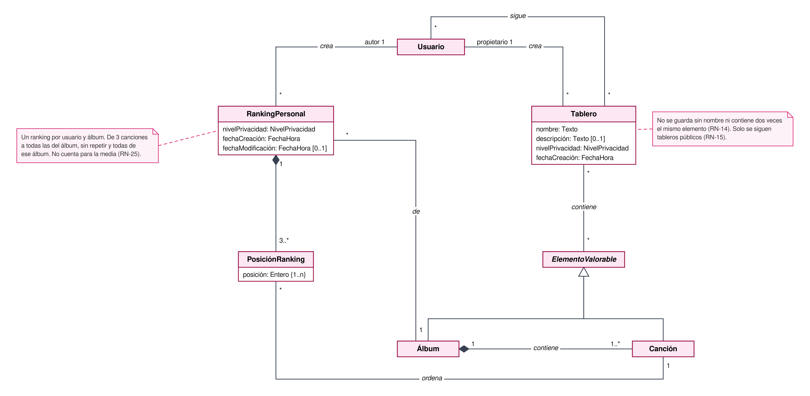
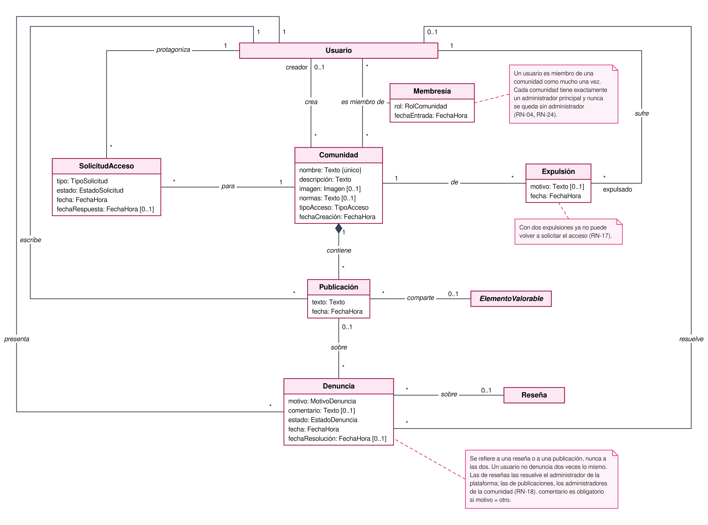
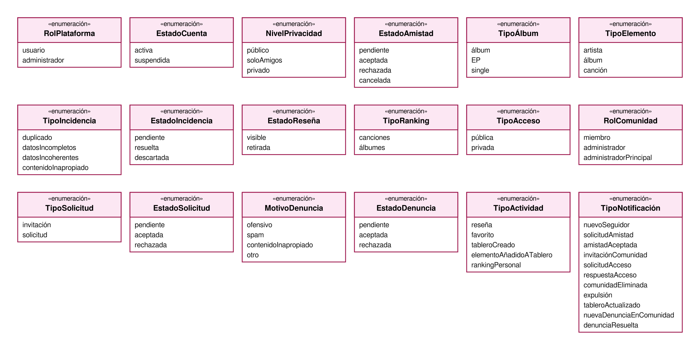

# Modelo conceptual

El modelo conceptual representa, con un diagrama de clases (Tema 4), las clases del dominio que salen de los requisitos de información, sus atributos con su tipo, las relaciones entre ellas y su multiplicidad. Para que se pueda leer bien se ha dividido en cinco vistas; una clase que aparece en varias vistas es la misma clase, y en cada vista solo se muestran sus atributos donde se describe. Los atributos opcionales llevan [0..1], los que no se pueden repetir {único} y los derivados (calculados a partir de otros datos) empiezan por «/». Las notas recogen las reglas de integridad, con la regla de negocio de la que salen. Las relaciones que guardan datos propios entre dos clases se representan como clases asociativas (línea discontinua). El esquema de la base de datos que implementa este modelo está en [db/schema.sql](../../db/schema.sql).

## Usuarios y red social

El usuario tiene una configuración de privacidad propia (composición). Seguimiento, Amistad y Bloqueo son clases asociativas de la relación del usuario consigo mismo: cada extremo indica el papel de cada usuario. El usuario recibe avisos por correo y genera actividad.

## Catálogo y agente de IA

Artistas, álbumes y canciones son elementos del catálogo importados de MusicBrainz. Álbumes y canciones se pueden valorar, por eso comparten la clase abstracta ElementoValorable. Un álbum y una canción pueden tener varios artistas, y la canción no existe sin su álbum (composición). El agente de IA registra sus correcciones seguras y crea incidencias que resuelve el administrador; lo que el administrador elimina queda excluido de las importaciones.

## Valoraciones y favoritos

Favorito y Reseña son clases asociativas: hay como mucho un favorito y una reseña por usuario y elemento. El ranking semanal guarda la posición que ocupa cada canción o álbum en cada cálculo.

## Tableros y rankings personales

El usuario crea tableros con canciones y álbumes y puede seguir los tableros públicos de otros. El ranking personal pertenece a un álbum y se compone de las posiciones de sus canciones.

## Comunidades y moderación

Membresía es la clase asociativa de la relación entre usuario y comunidad, y guarda el rol del usuario en ella. Las solicitudes de acceso y las expulsiones son clases propias porque la misma pareja usuario–comunidad puede tener varias. Las publicaciones forman parte de su comunidad (composición) y las denuncias se refieren a una publicación o a una reseña.

## Tipos enumerados

Valores posibles de los atributos de tipo enumerado que aparecen en las vistas anteriores.

## Cómo editarlo

El archivo [modelo-conceptual.drawio](modelo-conceptual.drawio) tiene las seis vistas en pestañas. Se abre en [app.diagrams.net](https://app.diagrams.net) (Abrir diagrama existente) y se exporta a PNG desde Archivo → Exportar como → PNG.
